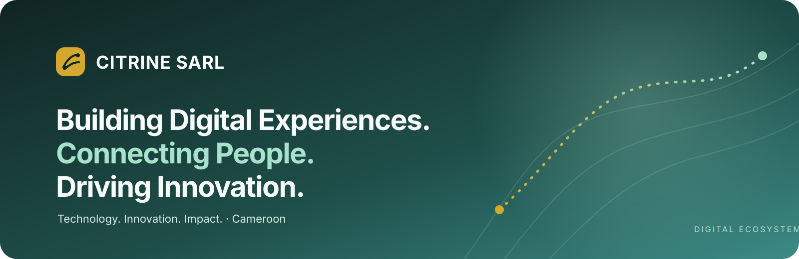

  

  <strong>Welcome to the official GitHub profile of CITRINE SARL.</strong>

  We build and operate digital products designed to simplify everyday services, improve connectivity and create better experiences through technology.

  
  
  

---

## 🌐 Who We Are

**CITRINE SARL** is a company committed to creating and delivering innovative digital solutions.

Through our products and services, we leverage technology to connect people, simplify processes and address real-world needs.

This GitHub account is the central technical space for managing, maintaining and preserving the source code of our digital ecosystem.

## 🚀 Our Digital Ecosystem

Our Hero products are designed to work together, connecting passengers, professional drivers and dedicated services.

<table>
  <tr>
    <td width="33%" align="center" valign="top">
      <h3>🚘 Hero Cab</h3>
      
Our mobility platform connecting passengers with professional drivers.

      
<strong>Mobile &amp; Web</strong>

      <a href="https://hero.citrine-mobilite.com/">Explore Hero Cab →</a>
    </td>
    <td width="33%" align="center" valign="top">
      <h3>🧑‍✈️ Hero Pilot</h3>
      
A dedicated digital environment for drivers operating within the Hero ecosystem.

      
<strong>Mobile &amp; Web</strong>

    </td>
    <td width="33%" align="center" valign="top">
      <h3>📍 Hero Kiosk</h3>
      
A digital solution designed to extend the Hero ecosystem through dedicated kiosk services.

      
<strong>Mobile &amp; Web</strong>

    </td>
  </tr>
</table>

## 🧩 Projects in This GitHub

Alongside our Hero products, these repositories support Citrine's internal operations and pricing intelligence.

<table>
  <tr>
    <td width="50%" valign="top">
      <h3>🏢 <a href="https://github.com/citrine-mobilite/citrine-management">Citrine Management</a></h3>
      
An internal management platform bringing team operations into one place, with HR, attendance, finance, tasks, inventory and document tools.

      
<a href="https://citrine-management.vercel.app">Explore the platform →</a>

      
<code>TypeScript</code> <code>React</code> <code>Firebase</code>

    </td>
    <td width="50%" valign="top">
      <h3>📊 <a href="https://github.com/citrine-mobilite/citrine-pricing">Citrine Pricing</a></h3>
      
A VTC pricing intelligence platform for comparing market fares, running price surveys and turning results into actionable reports.

      
<a href="https://citrine-pricing.vercel.app">Explore the platform →</a>

      
<code>TypeScript</code> <code>React</code> <code>Node.js</code>

    </td>
  </tr>
</table>

## 💻 Technology &amp; Infrastructure

  

Our products are built and maintained using modern technologies and development tools. The technology icons represent tools across our ecosystem; individual repositories may use different stacks.

## 🏗️ What You'll Find Here

- Web application source code.
- Mobile application projects.
- Backend services and APIs.
- Database structures and integrations.
- Internal tools and development resources.
- Project documentation and technical assets.

## 🔒 Engineering Principles

- **Ownership:** Maintaining control of our source code and digital assets.
- **Organization:** Keeping projects structured and properly versioned.
- **Reliability:** Building and maintaining dependable digital solutions.
- **Evolution:** Continuously improving our products and services.
- **Security:** Promoting responsible code management and access control.

## 🤝 Connect With Us

Interested in our products, business activities or potential collaborations?

  
  

---

  <strong>CITRINE SARL</strong> 
  <em>Technology. Innovation. Impact.</em>

